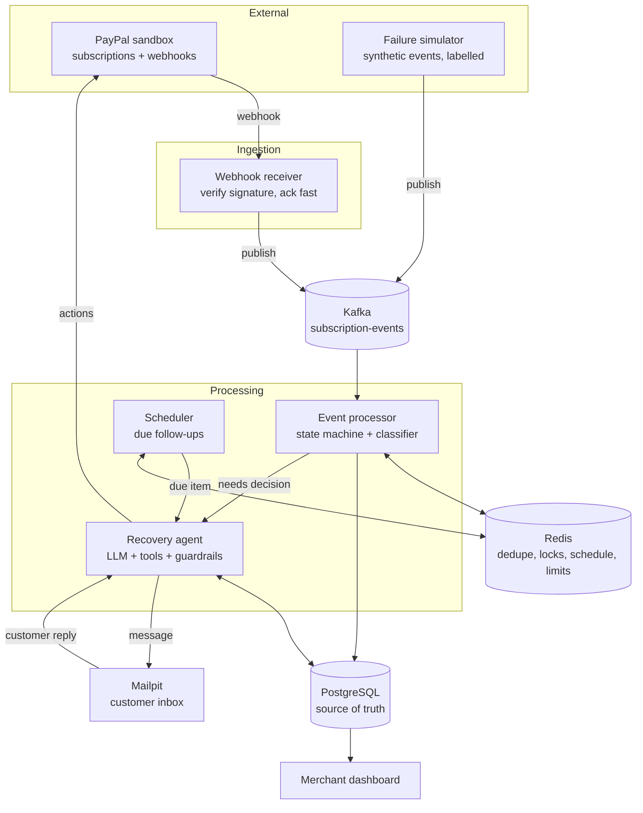
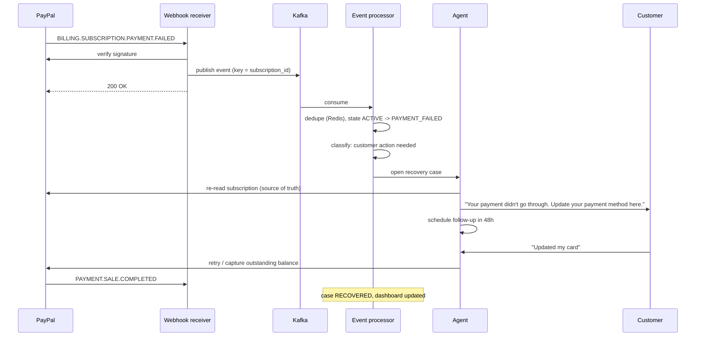

# High-level design: subscription recovery agent

## 1. Problem

When an automatic PayPal subscription payment fails, the merchant can lose
the payment and the customer. PayPal's intelligent retries re-attempt the
charge at a well-chosen time, which recovers failures that time can fix
(for example, a low balance). Failures that only the customer can fix
(expired card, funding source needs changing, account issue) need someone
to contact the customer, explain the exact fix, and offer options. PayPal's
own guidance leaves that step to the merchant. This system automates it.

**One-line pitch:** PayPal's retries recover what time can fix. Our agent
recovers what only the customer can fix.

## 2. Goals and non-goals

**Goals**
- React to every failed subscription payment within seconds, exactly once.
- Classify the failure and choose the right playbook.
- Contact the customer with a specific, helpful message, and handle replies.
- Take account actions (pause, downgrade, retry after fix) within limits the merchant sets.
- Warn customers before a renewal that is likely to fail (prevention).
- Show the merchant revenue at risk, revenue recovered, and why.

**Non-goals (for the hackathon)**
- Replacing or competing with PayPal's retry timing.
- Contacting customers after risk reversals or denied payments (the merchant reviews these).
- Multi-merchant onboarding, billing, or production-grade email delivery.
- Spark, Elasticsearch, or ML models. Not needed at this scale.

## 3. Actors

| Actor | Role |
|---|---|
| Customer | Subscribes on the demo app, receives messages, replies, fixes payment |
| Merchant | Sets policy (limits, approvals), watches the dashboard, approves escalations |
| PayPal | Bills subscriptions, retries, sends webhooks, executes account actions |
| Recovery agent | Decides the next step and acts through tools |

## 4. Architecture

## 5. Components

| Component | Responsibility | Tech |
|---|---|---|
| Demo app | Sells the Pro plan, confirms subscriptions server-side | FastAPI + PayPal JS SDK |
| Webhook receiver | Verifies PayPal's signature, publishes to Kafka, returns 200 in milliseconds | FastAPI |
| Failure simulator | Publishes realistic failure events in the same format, marked `source=simulator` | Python |
| Event processor | Deduplicates, updates subscriber state, classifies failures, opens recovery cases | Python Kafka consumer |
| Scheduler | Wakes up cases whose follow-up time has arrived | Python worker + Redis sorted set |
| Recovery agent | Reads the case, picks tools, writes messages, takes actions | LLM with tool calling |
| Guardrail layer | Enforces merchant policy in code before any tool runs | Python |
| Dashboard | At-risk revenue, recovered revenue, cases, agent reasoning, approvals | Simple web UI |

## 6. Main flows

### 6.1 Payment fails, customer must act (`PAYMENT_DENIED`, `PAYER_CANNOT_PAY`)

### 6.2 Payment fails, time can fix it (`INTERNAL_SERVER_ERROR`, or no reason yet)

The processor classifies it as temporary. The agent sends at most one short
heads-up ("we'll try again soon, no action needed") and lets PayPal's
intelligent retries handle timing. No extra retries from our side.

### 6.3 Customer can't pay right now

The customer replies "money is tight." The agent offers a pause or the Lite
plan, within merchant policy. A downgrade uses PayPal's revise endpoint,
which may send the customer an approval link. That's fine, because the
customer consents.

### 6.4 Risk-related or merchant-side failure

For a restricted payer account (`PAYER_ACCOUNT_RESTRICTED`), or a problem with the
merchant's own account (`PAYEE_ACCOUNT_RESTRICTED`, receiving limit, currency
mismatch), nobody contacts the customer. The processor escalates the case to the
merchant's approval queue in code, so these cases never reach the agent.

### 6.5 Prevention

A daily job checks renewals due in the next few days. If a subscriber has
recent failures (or, in simulated data, a card expiring before renewal), the
agent sends a friendly reminder before the charge is attempted.

## 7. Key design decisions

| Decision | Reason |
|---|---|
| Kafka between receiver and processing | PayPal delivers at least once and in bursts; the receiver must ack fast; crashes must not lose events; events can be replayed |
| Partition by `subscription_id` | Events for one customer are processed in order |
| Redis for dedupe, locks, schedule, rate limits | Duplicates are normal; follow-ups are time-based; workers must not conflict; customers must not be spammed |
| PostgreSQL as source of truth | Durable history for cases, messages, actions, and the dashboard |
| PayPal re-read before every action | The payment may have succeeded since the event was produced |
| Guardrails in code, not in the prompt | The LLM proposes; code decides whether it's allowed |
| Defer to PayPal for temporary failures | Extra attempts can hurt; PayPal already optimises timing |
| Human approval above policy limits | Money actions need accountability |
| Simulator clearly labelled | Honest demo; sandbox volume is too small to show scale |

## 8. Non-functional requirements

- **Idempotency:** each PayPal event ID is processed at most once; every PayPal write uses a `PayPal-Request-Id`.
- **Delivery:** at-least-once from Kafka, made safe by Redis dedupe.
- **Latency:** receiver responds in under 200 ms; first customer message within 1 minute.
- **Security:** webhook signatures verified; secrets only in `.env`; minimal customer data sent to the LLM (no full emails or payment details).
- **Auditability:** every agent decision is stored with its reasoning and the tool results.
- **Customer protection:** at most one message per customer per day, and none during quiet hours.

## 9. Deployment

Local Docker Compose for Kafka, Redis, PostgreSQL, and Mailpit. Python
services run on the host during development. The demo video is recorded
locally. A hosted deployment is optional.

## 10. Risks

| Risk | Mitigation |
|---|---|
| Sandbox can't trigger renewal failures (confirmed Week 1: negative testing only fails our own API calls) | Webhooks-simulator samples replayed to Kafka, and the labelled simulator |
| Failure reason codes are coarse (8 values, verified Week 1) | Combine with failure count, suspension and history; fetch the subscription when a real event has no reason |
| Downgrade needs customer re-approval | Treat the approval link as part of the flow |
| Scope creep | Core path working by end of Week 3; everything after is polish |
| LLM makes a bad call | Guardrails in code, merchant approvals, full audit log |

## 11. Timeline (submission Nov 12)

| Week | Dates | Deliverable |
|---|---|---|
| 1 | Oct 8 to 14 | Sandbox, plans, subscribe page, webhook registration, real payloads logged |
| 2 | Oct 15 to 21 | Verified receiver, Kafka, Redis dedupe, processor + state machine, Postgres |
| 3 | Oct 22 to 28 | Agent with tools and guardrails, Mailpit messages, scheduler. **Core path done** |
| 4 | Oct 29 to Nov 4 | Replies, pause/downgrade, prevention job, simulator, dashboard |
| 5 | Nov 5 to 12 | Polish, end-to-end tests, demo video, write-up, buffer |
